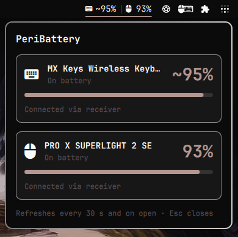

# PeriBattery

An Omarchy bar widget that shows the battery of your Logitech keyboard and mouse. It is a Linux port of the macOS menu bar app [PeriBattery](https://github.com/juancasanueva/SWIFTUI_battery).

<p align="center">
  
</p>

- **Bar**: keyboard glyph and percentage, a hairline separator, mouse glyph and percentage, and a bolt while a device charges. Levels at 20% or below turn the theme's urgent color; a charging device stays in the regular foreground color.
- **Panel**: one card per device with its name, level, charging state, a gauge and how it is connected.
- With no Logitech device online the bar shows a single muted glyph and the panel says so.

## How it works

The kernel driver `hid-logitech-hidpp` already talks HID++ to devices paired with a Logitech receiver and publishes each one as a power supply in `/sys/class/power_supply/hidpp_battery_N`. The widget lists that directory, keeps only entries named `hidpp_battery_` followed by a number, and reads six attributes of each: `model_name`, `serial_number`, `status`, `capacity`, `capacity_level` and `online`. A device plugged in over USB appears twice (behind the receiver and on the cable); entries with the same serial number are merged into one card, keeping the connected one.

UPower is deliberately not used: it hides peripherals the kernel marks `online=0`, which is exactly what a keyboard reports while it charges over its USB cable. Reading sysfs directly keeps such a keyboard visible as "Charging".

- sysfs sends no change notifications, so the widget re-reads the attributes every 30 seconds and whenever you open the panel.
- The files it reads are kernel-owned, read-only attributes under `/sys` (each at most 4 KiB). Missing attributes are treated as empty.
- No helper scripts or processes, no root, no network access, and it writes no files. The only persisted state is its own `showPercentage` setting in the widget's `shell.json` entry, which the Omarchy shell writes when you right-click.
- Device names are treated as untrusted text: markup and control characters are stripped and the length is capped before display.
- sysfs does not say whether a device is a keyboard or a mouse, so the widget decides by the device name: names containing "keyboard", "keys", "craft", "mechanical" or a K-model number (for example K850) are keyboards, everything else is a mouse.

Supported receivers are whatever the kernel driver supports, which includes Unifying, Bolt and Lightspeed. Some devices only report a coarse level (Full, High, Normal, Low, Critical); the widget maps those to 95, 80, 60, 20 and 5% like the macOS app and marks them with a `~`. A device that is charging but reports no level shows just its glyph and a bolt.

## Install

```bash
omarchy plugin add https://github.com/juancasanueva/omarchy-peribattery --enable
```

(The repository URL is a placeholder until the repository is published.)

For development, copy the folder to `~/.config/omarchy/plugins/juancasanueva.peribattery` and enable it:

```bash
omarchy plugin enable juancasanueva.peribattery
```

## Usage

- Left-click the widget to open the panel. Esc closes it.
- Right-click to show or hide the percentages in the bar.

## Troubleshooting

### The keyboard shows no percentage after unplugging its charging cable

While a keyboard such as the MX Keys charges, it reports no battery level, so the kernel sets `capacity_level` to `Unknown`. When you unplug the cable, the keyboard reports that it is discharging again but does not send a new level, and the kernel does not ask for one. It stays `Unknown` until the keyboard reconnects.

Turn the keyboard off and on with its power switch. It reconnects, the kernel reads the level again, and the percentage returns within a few seconds. You can check what the kernel has with:

```bash
cat /sys/class/power_supply/hidpp_battery_*/capacity_level
```

## Removing

```bash
omarchy plugin remove juancasanueva.peribattery
```

Nothing else persists: the plugin creates no files, caches or services. The widget's entry in `shell.json` (including `showPercentage`) is managed by the Omarchy shell.

## Tests

```bash
QT_QPA_PLATFORM=offscreen /usr/lib/qt6/bin/qmltestrunner -input tests
```

## License

MIT
